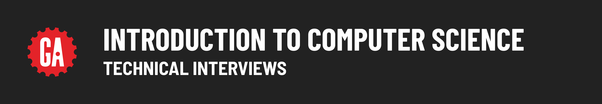
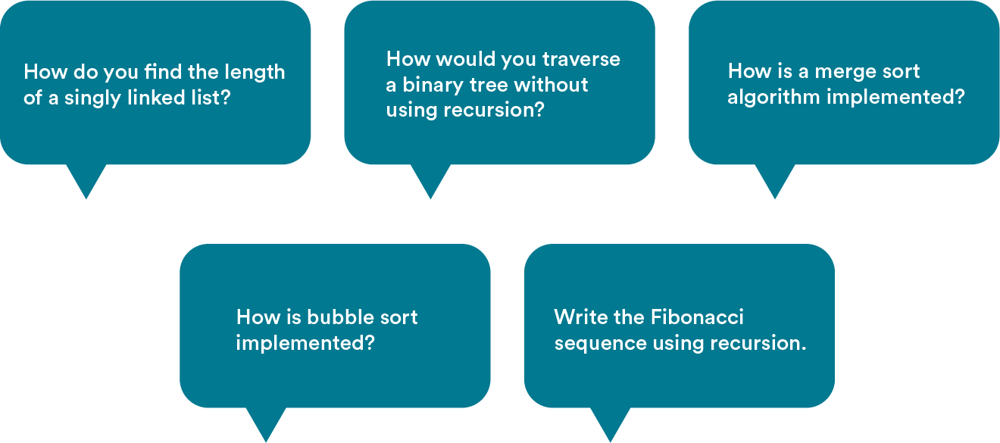

# 

**Learning objective:** By the end of this lesson, students will be able to explain the types of computer science topics they should study to prepare for technical interviews. 

## Let's talk about interviews

You may have already heard stories of the infamous whiteboarding components of engineering job interviews, where you’re given a question and asked to draw out a solution on the spot. Oftentimes, those questions relate to computer science. If just reading this sentence strikes fear in your heart, you’re not alone.

Here are the sorts of CS questions you might encounter in a job interview. (Spoiler alert: You may not know what all of these questions are about, but by the end of this computer science unit, you will!)

### Why CS?

The fundamentals of computer science are a popular interview topic for a couple of reasons:

- They show that you know and care about the world of programming.
- They’re a great way for interviewers to understand how you approach a problem.

Let's hear about what interviewers are looking for when they ask candidates about computer science.

TKTK VIDEO HERE

**----transcript start----**

*A lot of times when hiring managers are asking whiteboarding questions about data structures or underlying algorithms or computer science topics, or even object oriented programming, it's because they're trying to tease out knowledge and ability to learn and how much the person has the foundations of programming. Those concepts are not in any particular language; they're not tied to any particular language. So, do you know the concept? Can you do this job?*

*They're trying to see your problem solving skills and what you do know. Some of these problems you may actually see in person as well. Part of it is really difficult because at work, you're going to have Google, and you can always look these things up, but they're trying to filter out problem solving skills with the whiteboarding and talking about algorithms and all that.*

*Essentially, these interview questions aren't asking if you are an expert at algorithms or data structures. They are asking if you are able to deal with a problem, how will you go about it, and what tools do you have in your bag to be able to fix this problem?*

*It's not always just about getting the right answer. Sometimes, if you know the right answer off the top of your head, that's actually a negative, because you might skip walking through the thought process and how to solve it, which is really what they're looking for.*

**----transcript end----**

### No code allowed

Luckily for you, prepping for computer science interview questions doesn’t require memorizing long lines of code. As some of the instructors mentioned, you’ll typically be expected to draw out your approach to a problem on a whiteboard.

A lot of algorithms and data structures can easily be explained visually without any code. You’ll need to understand how they work on a conceptual level in order to successfully answer these interview questions.

The best part? Whiteboarding is easy to practice and learn!

### Looking ahead

Computer science is a vast discipline that covers topics ranging from the theory of programming languages to computer system architecture. It would be impossible to cover all of it here!

Instead, we’ll focus on the principles of computing — in other words, how computers approach and solve problems. The two important factors here are:

- **Algorithms**, or step-by-step processes for solving a problem.
- **Data structures**, or the way that information is organized in order to solve a problem.

Algorithms and data structures are two areas of computer science that come up frequently in technical interviews. The concepts we’ll cover here are ones that you may be asked to think through and whiteboard out.