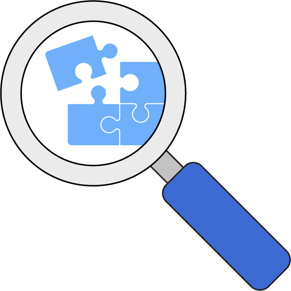
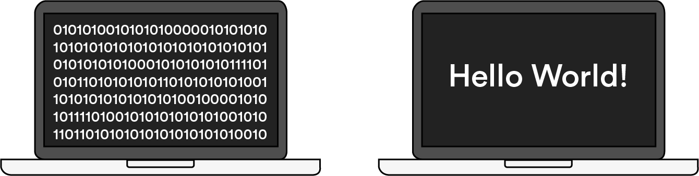
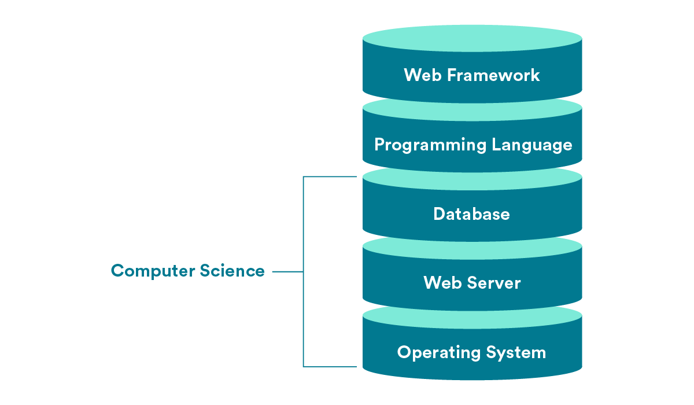

# 

**Learning objective:** By the end of this lesson, students will be able to define what computer science is.

## What is computer science, anyway?

TKTK VIDEO HERE

tktk do we want to include the video transcripts?

**transcript start**

*Computer science is really a discipline study of problem solving. We have a problem, that problem exists in a context with constraints, and we need some formal way of solving it.*

*Computer science is the art of using engineering and scientific methods to understand and leverage computers and technology.*

*Computer science is studying how to actually tell a computer how to do things. This looks different in a lot of different formats, but usually what we're talking about is about data structures, algorithms, how computers work, security, and all those things.*

*I think computer science is more the theory behind why certain aspects of programming are better or worse than other aspects, why best practices have been established, why those best practices are considered best practices. It's really the theory behind the application.*

**transcript end**

### Defining computer science

It’s a bit unfortunate that computer science has the word “computer” in its name, because it has many applications beyond just what we think of as a “computer.”

Instead, think of computer science as the study of the nature of computation; in other words, the study of problems, standardized solutions to those problems, and how to make those solutions more efficient.

### Layers of abstraction

Computer science is, by definition, an abstract field of study.

Does “abstraction” feel like an abstract concept? Think about it this way: When you drive a car, you’re putting your key in the ignition, using the accelerator and brake pedals, and monitoring the speed and fuel gauges so that it runs. You’re dealing with the car’s operating system in the abstract, using tools that its manufacturers designed to make driving simple and easy.

On the other hand, the mechanic who works on your car has to understand how the ignition connects to the engine, how the pedals actually make the car move, and everything else that happens “under the hood.” The mechanic is cutting through layers of abstraction to get down to the car’s physical operations.

### In programming terms...

The way that most people use computers — sending emails, browsing websites, creating documents — is like sitting in the driver’s seat of a car. Even writing code and building web applications is similarly abstract. You’re using functions, tools, and languages created by other engineers to make cool stuff.

Computer science studies all of the “under the hood” mechanics of computers that most people don’t think about. What actually is a programming language? Isn’t it crazy that they can be read across so many different machines? And how do you get from binary 0s and 1s to what you see on your screen?

In computer science, we’re cutting through those layers of abstraction down to how stuff really works.

### Finding yourself in CS

At this point, you might be wondering, “Where does computer science fit in with what I know about web development?”

We’ll be straight with you: Computer science deals mostly with parts of the tech stack you may not be interacting with all that much. Most of the programming you’re doing — building applications and websites that users interact with — sits at higher levels in the stack.

But computer science comes into play much lower in the stack, when you’re thinking about interactions between a database, a server, and your operating system.

