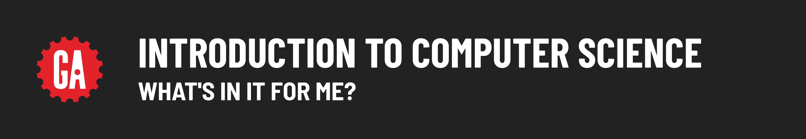

# 

**Learning objective:** By the end of this lesson, students will be able to explain how computer science is beneficial to them in their careers as software engineers. 

## What's in it for Me?

So, if you most likely won’t be working with computer science concepts all that much, why should you learn about them?

It’s a legitimate question! From our perspective, there are two vitally important reasons to learn (at least a bit) about computer science:

- It makes you a more well-rounded software engineer.
- It comes up all the time in technical job interviews.

Let’s see what our SEI instructors have to say.

TKTK VIDEO HERE

**----transcript start----**

*In the next 10 years, everybody's going to need to know how to write a program in any capacity, either to protect yourself or for security purposes in your home. Since we're creating this huge ecosystem of smart home, smart everything, we will need to know how to navigate through it. The value of computer science is tenfold in the times that we're living in right now.*

*Most of your life, most of your career is going to be focused on solving problems. Computer science, as a formal discipline of studying problem solving, is going to help you do that.*

*When you really dive into the weeds and you want to build something truly new - which you have the ability to do as a software engineer - computer science is what allows you to get there through code.*

*Learning computer science should be not just valuable on the job, but on a personal level, it can enable you to pursue things that you love. If you have a passion project, you're really passionate about helping stray animals in your neighborhood and you want to build this app to connect them with these different groups, you then have the power to do that. Or you want to build something for your family because you have a family event coming up. It goes beyond just work, and it's actually helping you put your ideas into action, and it can be empowering to be solving problems and thinking critically like that.*

**----transcript end----**

